# EinkOS

**面向墨水屏设备的开源 Linux 桌面与应用系统。**

基于 C、LVGL 8.3.1 和 Linux 用户态接口，提供黑白手帐桌面、日历/农历、TXT 阅读器、
手机 Wi-Fi 配网和蓝牙管理。首版支持 **100ASK T113-PRO + 3.52 英寸 240×360 单色墨水屏**，
配套系统使用 TinaSDK / OpenWrt。

**当前状态：v0.1.0 资产已准备为发布草稿；实机验收与完整系统源码/厂商资料审核尚未完成，
暂不提供公开稳定版下载。** 草稿需仓库权限账号登录查看，公众发布页不会显示草稿附件。
源码可正常获取，CI 和主机/交叉构建已通过。首版不包含 OTA、其他分辨率或通用 PC 桌面。

[使用指南](docs/USER_GUIDE.md) · [构建](docs/BUILD.md) · [架构](docs/ARCHITECTURE.md) ·
[开发要求](docs/DEVELOPMENT.md) · [发布门禁](docs/RELEASING.md) · [仓库边界](docs/REPOSITORIES.md)

## 当前镜像对应的源码版本

| 项目 | v0.1.0 对应版本 |
| --- | --- |
| 应用 | [`v0.1.0` · `087cbaf`](https://github.com/dshanpi/EinkOS/tree/087cbaf80cebcbc5d101d37ab3520b3c6fe461c5) |
| 硬件开发分支 | [`einkos-240x360`](https://github.com/DongshanPI/100ASK_T113-PRO_TinaSDK5/tree/einkos-240x360) |
| 硬件固定版本 | [`einkos-v0.1.0` · `d24ebd7`](https://github.com/DongshanPI/100ASK_T113-PRO_TinaSDK5/tree/d24ebd7af24d4b07b0912b19f06a6dad22123eb5) |
| SDK 基线 | TinaSDK 5.0 v1.2；[122 个组件的提交清单](releases/v0.1.0-sdk.json) |
| 系统配置 | `t113 / evb1_auto_nand / linux-5.4 / openwrt` |

[版本锁定文件](releases/v0.1.0.json) 将两个仓库的提交、SDK 清单和镜像 SHA-256 绑定。
复现发布版本时使用固定标签/提交，不能直接使用两个分支的最新代码。
关联方式、获取命令及当前 SDK 补丁记录限制见 [版本关联说明](docs/VERSIONS.md)。

## 全部 UI 页面与主要状态

以下 **29 张截图**覆盖全部 11 个桌面路由、阅读/连接/异常等主要状态，以及手机配网网页。
桌面直接运行生产 `ui.c`、LVGL 和同一套字体，输出 240×360 黑白帧；手机页面由浏览器
捕获生产 HTML 模板。时间、网络、设备和资源数据均为虚构演示数据。
**这些是源码渲染截图，不是实机照片或硬件验收证明。** 当前长提示裁切与部分符号缺字也如实保留。

| 主页 | 英文主页 | 时间恢复待校准 |
| --- | --- | --- |
| 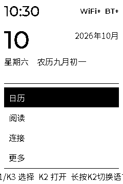 | 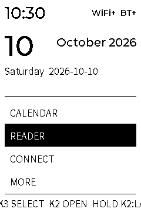 | 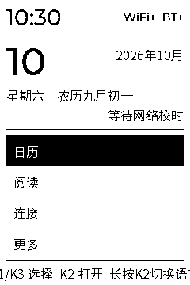 |

| 时间未设置 | 本月日历 | 月份浏览 |
| --- | --- | --- |
| 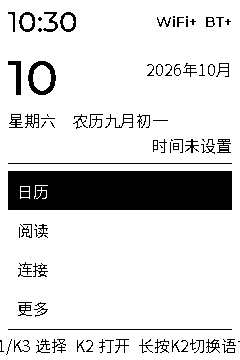 |  |  |

| 空书库 | 书库 | 阅读正文 |
| --- | --- | --- |
|  | 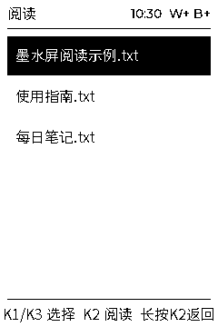 |  |

| 书签状态 | 阅读操作菜单 | 连接入口 |
| --- | --- | --- |
| 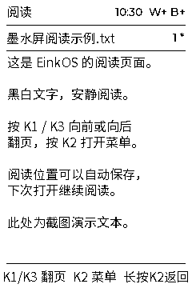 | 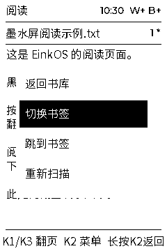 | 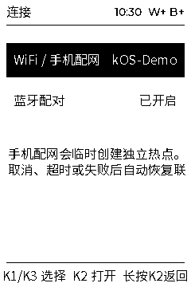 |

| Wi-Fi 扫描结果 | 手机配网热点 | Wi-Fi 失败状态 |
| --- | --- | --- |
| 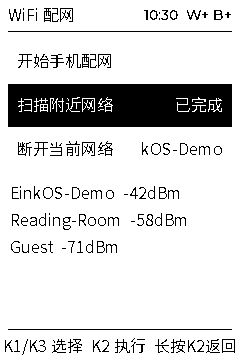 | 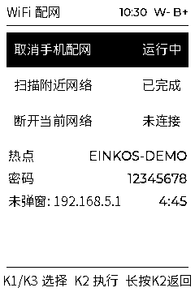 | 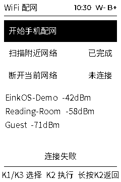 |

| 蓝牙设备列表 | 蓝牙扫描 | 蓝牙配对确认 |
| --- | --- | --- |
| 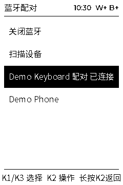 | 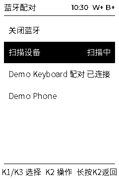 | 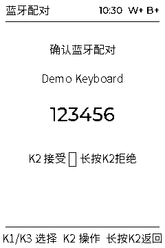 |

| PIN / Passkey 输入 | 蓝牙不可用 | 更多应用 |
| --- | --- | --- |
| 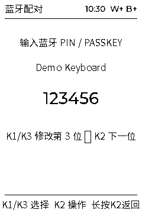 |  | 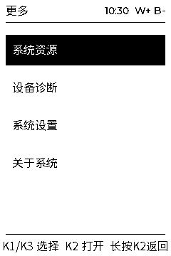 |

| 系统资源 | 设备诊断 | 刷新失败诊断 |
| --- | --- | --- |
| 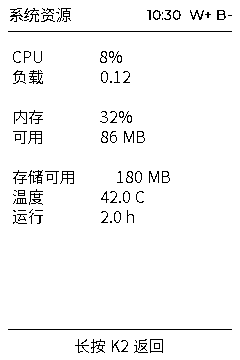 | 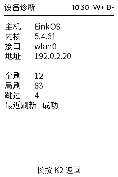 |  |

| 系统设置 | 关于 EinkOS | 手机配网表单 |
| --- | --- | --- |
| 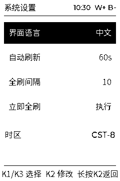 | 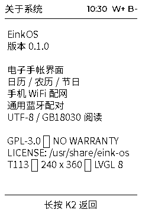 | 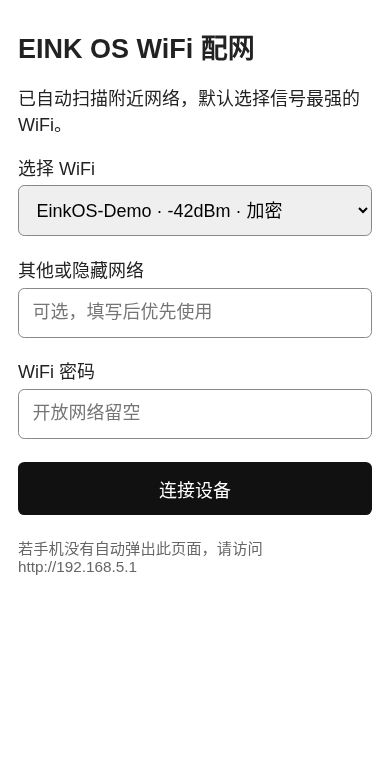 |

| 手机配网成功 | 手机配网失败 |  |
| --- | --- | --- |
|  |  |  |

生成方法和来源哈希见 [截图说明](docs/SCREENSHOTS.md)。新增页面必须同步扩充截图覆盖。

## 桌面框架

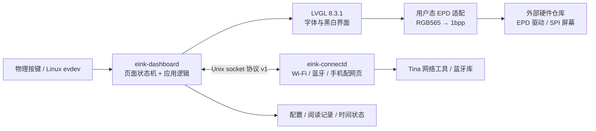

桌面和连接服务由 procd 独立启动。`main.c` 管理页面与按键状态，`ui.c` 构建 LVGL 对象，
显示适配负责 10800 字节单色帧和刷新 ioctl，驱动负责硬件通信与波形。
当前 IPC 为同步请求/响应，双进程不代表所有网络调用都不会阻塞界面。
完整的数据流、接口和实现限制见 [架构说明](docs/ARCHITECTURE.md)。

## 功能与实现

| 功能 | 实现方式 | 主要入口 |
| --- | --- | --- |
| 手帐桌面 | 日期、农历、状态及四个应用入口；按键选择 | `main.c` / `ui.c` |
| 日历与节日 | 月历浏览、今日定位、1900–2100 农历转换 | `lunar.c` |
| TXT 阅读 | UTF-8 / GB18030、目录扫描、按宽度单位分页、续读和单书签 | `reader.c` |
| 手机 Wi-Fi 配网 | 临时 AP、网页选网、隐藏 SSID、浏览器校时、退出恢复 STA | `platforms/tina/connectd.c` |
| 蓝牙管理 | 厂商库动态加载、扫描配对、PIN/确认、连接/断开及硬件不可用降级 | `platforms/tina/connectd.c` |
| 资源与诊断 | Linux 系统信息、EPD 刷新计数和错误状态 | `system_stats.c` / EPD ioctl |
| 设置与时间 | 按键映射、中英文、刷新周期、时间恢复与保存 | `settings.c` / `time_state.c` |
| 墨水屏刷新 | GC/DU 模式、周期刷新和累计局刷后的全刷 | `main.c` / `platforms/tina/epd_disp.c` |

主页 K1/K3 选择、K2 打开；K2 长按逐级返回，主页长按切换语言。
阅读文件放入 `/mnt/UDISK/books` 或 `/mnt/SDCARD/books`。具体限制见 [用户指南](docs/USER_GUIDE.md)。

## 仓库与代码边界

| 位置 | 负责内容 |
| --- | --- |
| [dshanpi/EinkOS](https://github.com/dshanpi/EinkOS) | 桌面、应用、连接服务、用户态适配、测试、使用文档、开发技能、截图及发布工具 |
| [DongshanPI/100ASK_T113-PRO_TinaSDK5](https://github.com/DongshanPI/100ASK_T113-PRO_TinaSDK5/tree/einkos-240x360) | 内核驱动、设备树、Bootloader、板级配置、硬件测试工具、OpenWrt 集成及系统镜像构建 |
| [EinkOS Releases](https://github.com/dshanpi/EinkOS/releases) | 每个版本的源码包、配套 `.img.gz` 系统镜像、校验和、构建/验证信息及版本说明 |
| [dshanpi/lynx-releases](https://github.com/dshanpi/lynx-releases) | 用户统一获取 LYNX 安装及烧录工具的入口 |

应用只在 EinkOS 维护。硬件仓库按固定应用提交和源码 SHA-256 构建，不保留第二份应用副本。
应用的服务脚本/默认配置放在 EinkOS，板级 OpenWrt 包配方放在硬件仓库。
文档 HEAD 可以更新，但不能冒充旧固件实际使用的应用提交。详见 [边界说明](docs/REPOSITORIES.md)。

## 安装配套 Linux 系统

镜像公开后，从 [EinkOS Releases](https://github.com/dshanpi/EinkOS/releases) 获取对应板型的
`.img.gz` 和校验和，校验后解压得到 `.img`，统一使用
[LYNX｜芯桥](https://github.com/dshanpi/lynx-releases) 烧录。
**全量烧录会清除目标存储数据，先备份书籍与配置。** 不将 `.gz` 直接当作可烧录镜像。
操作步骤和板型限制见 [安装指南](docs/INSTALL.md)。

## 构建、开发与 Skills

```sh
git clone https://github.com/dshanpi/EinkOS.git
cd EinkOS
make test
make -j2 eink-dashboard
./eink-dashboard --version
make -j2 screenshots
python3 scripts/check_docs.py
```

主机命令验证逻辑和真实 UI 渲染；实际显示需要目标驱动，连接服务交叉编译还需要 Tina
厂商头文件。工具链、sysroot 和系统构建参见 [BUILD](docs/BUILD.md)。

开发者和编码助手应遵循 [AGENTS.md](AGENTS.md) 与 [开发要求](docs/DEVELOPMENT.md)。
仓库附带 [einkos-development 技能](skills/einkos-development/SKILL.md)，用于应用修改、
截图再生成和发布验证；不自动修改用户的全局技能配置。

- 保留程序路径、配置/状态、socket 协议及 EPD ABI；变更时说明兼容与迁移。
- UI/字体变化要更新截图并检查裁切；连接服务和硬件相关变化要记录实际板端验证。
- 不提交真实网络密码、个人设备信息、令牌、固件和编译产物到 Git。
- CI 检查逻辑测试、发布门禁测试、截图重现、页面覆盖、链接和独立源码构建。

## 发布门禁

| 阶段 | 必须满足 |
| --- | --- |
| Draft 草稿 | 应用源码包和 `.img.gz`、校验和、构建/验证记录、版本锁；应用/硬件标签、SDK 清单、包配方与镜像哈希一致 |
| 公开预发布 | 草稿检查通过；构建测试全部通过；完整对应源码/厂商说明审核有证据；未测硬件项目明确标记，不能有已知失败项 |
| 正式版 | 预发布条件全部满足；冷启动、按键、显示、阅读、网络、时间、蓝牙降级及 LYNX 烧录全部验收通过 |

```sh
python3 scripts/check_release.py dist --channel draft
python3 scripts/check_release.py dist --channel prerelease
python3 scripts/check_release.py dist --channel stable
```

上传工具先创建草稿；公开工具重新下载远端附件验证，通过后才改变发布状态。
当前 v0.1.0 仍缺实机与系统来源审核证据，不能用截图代替验收。详见 [发布流程与证据格式](docs/RELEASING.md)。

## 开源与许可证

自有应用采用 GPL-3.0-only；LVGL 使用 MIT、字体子集保留 OFL，UAPI 与驱动保留原许可证。
见 [LICENSE](LICENSE)、[第三方声明](THIRD_PARTY_NOTICES) 和 [系统源码说明](docs/SOURCES.md)。
完整 Linux 镜像包含不同来源的组件，应用开源不代表厂商固件也是 GPL。

## English

EinkOS is an open-source Linux e-paper desktop and application suite for the 100ASK T113-PRO
with a 240×360 monochrome panel. The gallery contains actual LVGL-rendered desktop captures
and browser captures of the provisioning HTML, using fictional fixture data; they are not hardware photographs.
Drivers and board support remain in the separate hardware repository. Firmware is distributed through
EinkOS Releases and installed using [LYNX](https://github.com/dshanpi/lynx-releases).
The current firmware is a draft pending hardware validation and complete system-source/distribution evidence.
