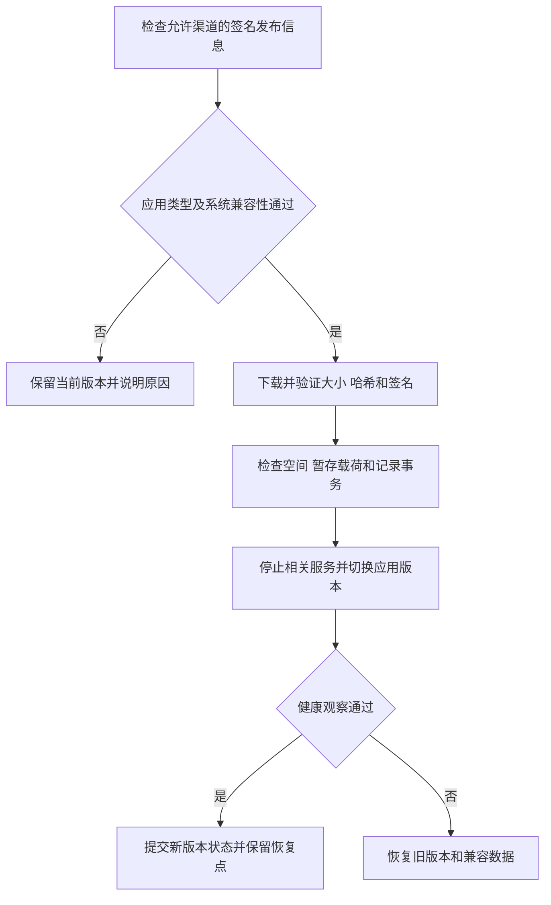

# 接入应用发布与自动更新

EinkOS 的应用更新线负责桌面、内置应用、连接服务、字体/资源和兼容的用户态适配。目标是：**Linux 基线保持稳定，桌面独立发布；设备只安装与自身系统兼容的可信应用版本，失败时恢复到已知可用版本。**

本页依据 [DSP-LINUX-001 1.1.0](../standards/linux-board-release/v1.1.0/SPEC.md)说明发布端、系统端和桌面端如何接入。当前仓库的历史 T113 系统发布工具不包含应用打包、签名及设备更新器；下述流程是接入和验收要求，不是已存在的菜单名称或 CLI 命令。支持自动更新的实际系统 Release 必须给出相应入口、版本和实测证据。

## 1. 明确三方职责

| 参与方 | 负责内容 | 交付依据 |
| --- | --- | --- |
| 应用维护者 | 编译各目标应用、打包、声明兼容系统、签名、发布与回退验证 | 应用源码提交、签名清单、目标包和验收记录 |
| 系统维护者 | 预置更新器、可信公钥、系统契约、受管目录、服务管理及恢复机制 | 可安装系统基线与对应升级/回退测试 |
| 桌面与设备更新服务 | 显示版本/更新状态，按用户策略检查、下载、安装、报告故障 | 更新事务、健康检查、设备当前版本及失败日志 |

桌面负责交互；需要权限的校验、文件切换和恢复由受控更新服务执行。更新服务不能依赖新桌面始终健康，才能在桌面启动失败时完成回退。版本检查和下载不应阻塞按键与绘制循环；这一要求不代表现有同步连接 IPC 已经改为异步。

## 2. 建立可更新的系统基线

系统维护者根据[系统契约模板](../standards/linux-board-release/v1.1.0/templates/system-contract.json)填写真实运行环境，并实现对应能力。

| 契约信息 | 设备安装前必须核对的内容 |
| --- | --- |
| 板型与运行环境 | board_id、硬件修订、CPU 架构、调用 ABI、libc 和动态加载器 |
| 系统接口 | 契约家族/版本、EPD ABI、服务契约、网络/蓝牙等能力与运行库 |
| 更新器 | 更新器和协议版本、可信密钥 ID、事务恢复与回退能力 |
| 安装及数据范围 | 允许写入的应用根目录、独立用户数据目录、健康检查约定 |

系统契约由系统发布管理。应用包不能修改它、替换信任根，或通过改变版本字段强行满足兼容条件。`100ask_t113s3-pro` 的新契约应使用经核对的板卡身份；旧发布中的名称差异通过明确映射处理，不使用字符串模糊匹配。

版本化应用目录、暂存区、当前版本指针和旧版本保留区必须处于契约允许范围内。首次引入这一布局属于系统基线接入；要保留既有程序入口和数据路径，或提供单独验收的迁移。当前源码没有默认可用的版本目录布局。

## 3. 制作应用 Release

1. **定范围。** 仅改变应用且系统接口兼容时，选择 `release_kind=application`。修改驱动、DTB、内核、Bootloader、基础库、分区或更新基础设施时转[系统升级](SYSTEM_OTA.md)。
2. **固定来源。** 固定应用完整提交、应用版本和依赖来源，创建独立应用标签 `app-vX.Y.Z`。兼容应用发布不要求硬件仓库产生新提交，也不要求 SDK 重建。
3. **逐目标构建。** 使用各系统对应的工具链/sysroot；按架构、libc、接口及后端生成目标包。相同版本可含多个目标包，不等于一个二进制通用于所有板卡。
4. **生成清单。** 按[应用清单模板](../standards/linux-board-release/v1.1.0/templates/application-release.json)声明支持的系统契约、实际验收镜像哈希、运行依赖、最低更新器版本、允许的来源应用版本及数据迁移/回退条件。
5. **执行升级验收。** 在声明的每个目标基线上验证正常更新、错误目标拒绝、断网/断电、启动失败和数据恢复；按[应用验收模板](../standards/linux-board-release/v1.1.0/templates/application-validation.json)记录真实证据。
6. **签名和上传。** 签名最终清单原始字节，绑定渠道、升级顺序、全部载荷和验证资料。发布签名后不再改写清单。
7. **远端复核与放行。** 从 GitHub 下载实际附件，复核签名、哈希、标签和目标矩阵。草稿不进入设备更新源；预发布仅供明确选择该渠道的设备使用。

每个应用 Release 至少包含：

| 附件 | 用途 |
| --- | --- |
| 应用源码归档 | 与实际应用提交一致，可独立获取和构建 |
| `EinkOS-app-v<version>-<target>.tar.gz` | 单一目标的应用载荷；命名占位符须由实际版本和目标替换 |
| `application-release.json` 与对应签名 | 设备选择和验证更新的权威元数据 |
| `application-build-info.json` | 工具链、依赖及构建来源 |
| `application-validation.json` | 绑定目标包和系统基线的升级/回退证据 |
| `SHA256SUMS` 与版本说明 | 下载完整性核对、变更和已知问题 |

清单不包含自身及自身签名的哈希；`SHA256SUMS` 可以覆盖二者，避免循环引用。散列校验不能替代可信签名。签名私钥保留在受控发布环境，不放入 Git、附件或设备；可信公钥由系统预置或经过验证的轮换流程建立。

现有 `scripts/release.py`、`check_release.py`、`publish-release.sh` 和 `promote-release.sh` 只处理历史 T113 系统资产，不能用于上述应用包。应用发布工具实现后，应提供实际命令、输入输出及拒绝用例，不能靠手填清单代替门禁。

## 4. 设备如何选择并安装更新

更新源使用 [EinkOS Releases](https://github.com/dshanpi/EinkOS/releases) 的已发布资产，由签名清单决定候选，不直接安装 GitHub 标注为 “Latest” 的任意附件。

下载可重试，恢复下载后仍须校验完整载荷。离线、证书/时间异常、GitHub 限流或签名验证失败时继续使用旧版，并退避重试；不得关闭 TLS 验证或退回不可信下载地址。

安装前持有安装锁，确认空间、供电条件和设备是否处于可中断的操作阶段。包文件和安装钩子都须限制写入范围，拒绝越界路径、链接和特殊文件。保存阅读状态后停止桌面，再按依赖关系处理连接服务；启动时先恢复依赖服务，再启动桌面。断电后从持久化事务恢复，不能仅依赖进程退出时的清理代码。

健康检查至少包含新进程稳定运行、版本正确、关键 IPC 可用、状态可读，以及目标桌面/显示和基本功能检查。观察超时或失败时回退到本机已知可用版本，记录失败候选并避免无限重装。

## 5. 用户如何使用自动更新

以下是接入后的交互约定，实际入口由对应版本的用户手册给出。当前菜单没有这些入口时，不能通过修改普通配置文件假定已经开启。

1. 查看当前**系统版本和应用版本**，确认系统具备应用 OTA 能力，完成数据备份。
2. 选择“仅检查并提示”“确认后安装”或“允许自动安装”的产品策略。默认使用稳定渠道；开启自动安装需要用户明确选择，稳定 Release 也不自动等同于设备授权。
3. 查看候选版本、更新内容、兼容结果、下载量及是否会中断连接。后台下载期间可继续使用桌面；安装须等阅读/配网等操作进入安全时机。
4. 安装完成后核对应用版本，检查桌面、阅读进度和连接功能。普通应用切换通常只重启相关服务；是否需要整机重启应由清单及发布说明明确。
5. 若自动恢复旧版，查看失败原因后继续使用旧版，不反复强制安装同一失败版本。

用户界面至少应区分检查中、无更新、待确认、下载中、待安装、健康检查中、更新成功、已回退和失败。错误提示给出可处理原因，例如系统基线不兼容、空间不足或签名无效。

## 6. 回滚与用户数据

应用回滚恢复的是桌面及相关用户态组件，不回退内核或整套 Linux。书籍、阅读进度、书签、配置和网络状态独立于应用版本区，不随升级包覆盖。

安装新版本前明确数据格式是否可由旧版本读取。若有迁移，备份和恢复必须与代码切换构成一致事务。不可逆迁移且没有恢复方案时，禁止无人值守升级。健康观察期间避免产生旧版无法恢复的新状态；回退时也不能静默丢掉观察期间的用户操作。

故障恢复到本机已知良好版本，与远端任意降级不同。签名清单中的升级顺序、渠道和允许的来源版本应防止重放旧包；回退策略须允许可信的本机故障恢复，不能为了回退而关闭防重放检查。

更新器自身、可信密钥或事务格式的变更，需要独立验证的自更新/迁移路径；没有专项实现前走系统线，不混进普通桌面包。
