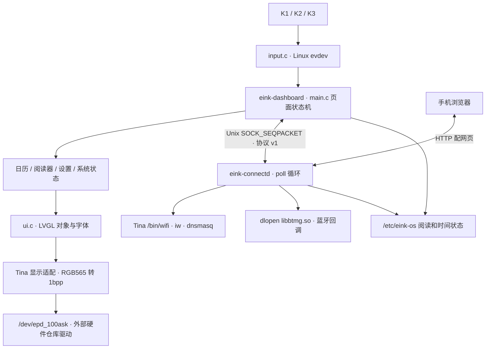

# 桌面框架与实现

EinkOS 是 C 编写的 LVGL 8.3.1 用户态桌面及应用集合，运行于现有 Linux / OpenWrt
系统之上。它通过 Linux 输入事件、Unix socket 和 EPD 字符设备工作；首版没有
窗口管理器、应用插件加载器、网页桌面、通用 framebuffer 后端或 PC 交互模拟器。

## 进程与数据流

procd 先启动连接服务（94），再启动桌面（95），并负责进程重启和日志。
桌面服务启动前检查 `/dev/epd_100ask`。连接服务单独维护网络/蓝牙状态，
桌面通过 `connect_client.c` 发送命令并获取状态结构。

**当前 IPC 是同步请求/响应，且客户端未设置收发超时。** 服务端处理命令后才回复，
部分厂商操作也会等待子进程结束。因此双进程实现不等于网络操作完全不会阻塞界面；
不能把未来的异步请求队列、取消或超时机制写成已经实现的功能。

## 页面与刷新

`main.c` 保存当前页面、菜单选择、日历偏移和阅读状态；`ui.c` 只构建页面对象。
每次渲染清理并重建当前 LVGL 屏幕。当前 11 个页面由 `enum desktop_screen` 定义，
主页连接到日历、阅读、连接和更多；“更多”包含资源、诊断、设置与关于。

主循环约每 20 ms 处理一次 LVGL 和非阻塞输入；每 2 秒查询连接状态。
默认 60 秒周期刷新，菜单选择通常使用 DU，页面切换和阅读翻页使用 GC，
连续局刷到配置阈值后转全刷；周期刷新分支在距上次全刷达到 30 分钟时请求 GC。
这不是 Linux 桌面的持续视频刷新。

显示适配申请 240×360 RGB565 缓冲，将亮度按阈值 128 转为 1bpp，MSB first，
白色为 1、黑色为 0。每帧向字符设备写入 10800 字节，通过 ioctl 选择 GC/DU/5S
及读取统计。驱动负责 SPI、波形、BUSY 处理和重复帧跳过；源码在硬件仓库。

`tools/ui_capture.c` 只为文档注册内存显示驱动，调用同一个 `desktop_ui_render()`，
使用相同字体和黑白阈值；它不运行产品主循环，也不连接开发板。详见 [截图说明](SCREENSHOTS.md)。

## 功能实现对应关系

| 功能 | 实现入口 | 当前行为与边界 |
| --- | --- | --- |
| 页面切换 | `src/main.c`、`src/ui.c` | 11 个固定页面；没有动态应用加载 |
| 输入 | `src/input.c` | 扫描 event0–7；导航去重 120 ms；K2 松开时按 1200 ms 阈值判断长按 |
| 日历/农历 | `src/lunar.c` | 公历月历、1900–2100 农历、常用节日 |
| 阅读 | `src/reader.c` | UTF-8/BOM 和 GB18030；128 文件、两层子目录、单文件 32 MiB；单字节按 1 单位、多字节按 2 单位分页 |
| 书签/续读 | `src/reader.c` | 记录当前阅读位置和单书签；临时文件、fsync、rename；文件大小/修改时间变化时不沿用旧位置 |
| 配网 | `platforms/tina/connectd.c` | STA/AP 切换、HTTP 表单、随机热点密码、浏览器上传时间；默认 300 秒退出热点 |
| Wi-Fi 排序 | `src/wifi_results.c` | 解析、去重、按信号排序；手机表单支持隐藏 SSID |
| 蓝牙 | `platforms/tina/connectd.c` | 动态加载厂商库，扫描/配对/连接；确认或输入 PIN；无 ttyS1/库时降级 |
| 设置 | `src/settings.c` | 配置文件、默认值、按键兼容映射；中英文、刷新周期与全刷间隔 |
| 时间 | `src/time_state.c` | 从保存时间/构建时间恢复，浏览器或 NTP 校时，6 小时和退出时保存 |
| 资源/诊断 | `src/system_stats.c`、EPD ioctl | CPU/内存/磁盘/温度/网络信息及驱动刷新统计 |

蓝牙移除和忘记 Wi-Fi 等命令存在于协议中，但当前桌面没有为全部协议命令提供独立入口。
阅读器分页使用宽度单位近似，不是逐字查询实际字体 advance 的完整排版引擎。
“时间准确”状态含当前实现的时间/连接启发式判断，不等于已独立验证 NTP 同步质量。

## 接口与状态兼容

- 运行程序：`/usr/bin/eink-dashboard`、`/usr/bin/eink-connectd`。
- 配置：`/etc/eink-dashboard.conf`；状态：`/etc/eink-os/reader.state`、`time.state`、`bluetooth.enabled`。
- 阅读目录：`/mnt/UDISK/books`、`/mnt/SDCARD/books`；随包示例位于 `/usr/share/eink-os/books`。
- 本地协议：`/var/run/eink-connectd.sock`，magic `0x45494e4b`、version `1`，原生 C 固定结构，完整消息长度校验；不是跨架构/跨端序网络协议。
- 屏幕 ABI：`include/uapi/epd_100ask.h` 保留上游来源和 syscall-note；修改需与硬件仓库同步。

配置/状态格式、协议布局或 ioctl 的变化必须在 PR 中说明兼容与迁移方式。
首版面向同一板级环境；新增分辨率、systemd、其他 Wi-Fi/蓝牙后端需要实际实现及验收。
