# 查看界面截图

以下 **29 张截图**覆盖全部 11 个桌面路由、阅读/连接/异常等主要状态，以及手机配网网页。
桌面直接运行生产 `ui.c`、LVGL 和同一套字体，输出 240×360 黑白帧；手机页面由浏览器
捕获生产 HTML 模板。时间、网络、设备和资源数据均为虚构演示数据。
**这些是源码渲染截图，不是实机照片或硬件验收证明。** 当前长提示裁切与部分符号缺字也如实保留。

| 主页 | 英文主页 | 时间恢复待校准 |
| --- | --- | --- |
| 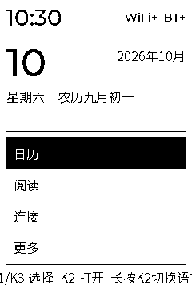 | 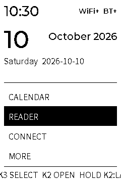 | 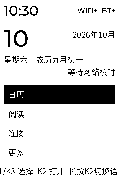 |

| 时间未设置 | 本月日历 | 月份浏览 |
| --- | --- | --- |
| 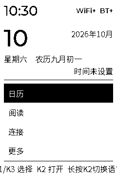 | 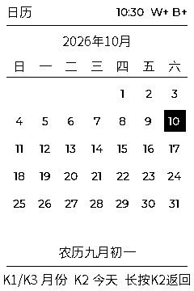 | 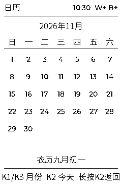 |

| 空书库 | 书库 | 阅读正文 |
| --- | --- | --- |
| 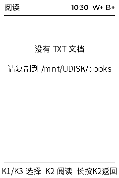 | 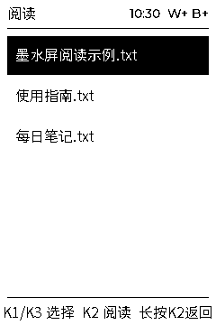 | 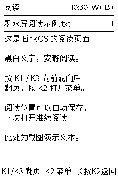 |

| 书签状态 | 阅读操作菜单 | 连接入口 |
| --- | --- | --- |
|  | 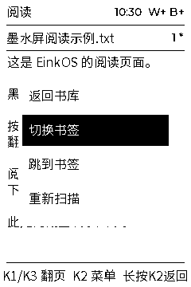 | 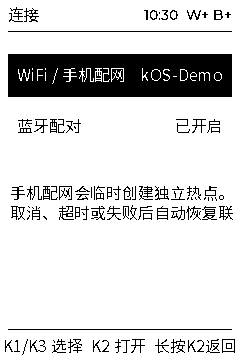 |

| Wi-Fi 扫描结果 | 手机配网热点 | Wi-Fi 失败状态 |
| --- | --- | --- |
| 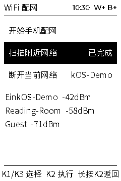 | 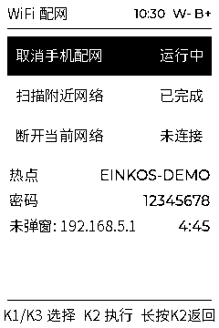 | 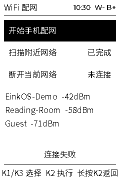 |

| 蓝牙设备列表 | 蓝牙扫描 | 蓝牙配对确认 |
| --- | --- | --- |
| 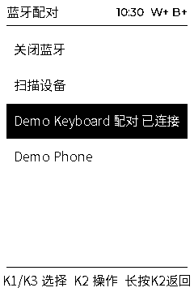 | 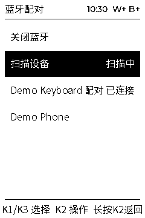 | 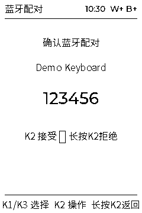 |

| PIN / Passkey 输入 | 蓝牙不可用 | 更多应用 |
| --- | --- | --- |
| 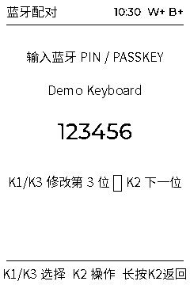 | 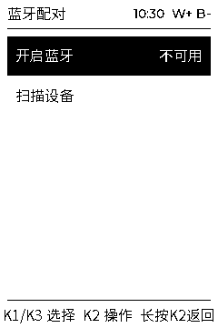 | 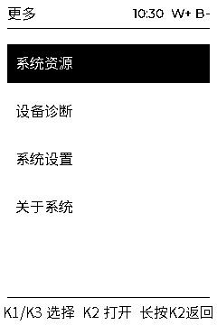 |

| 系统资源 | 设备诊断 | 刷新失败诊断 |
| --- | --- | --- |
| 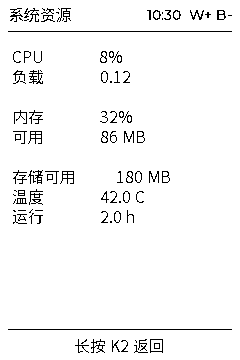 |  | 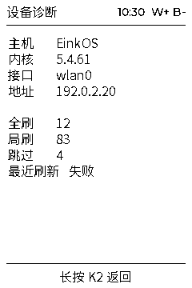 |

| 系统设置 | 关于 EinkOS | 手机配网表单 |
| --- | --- | --- |
| 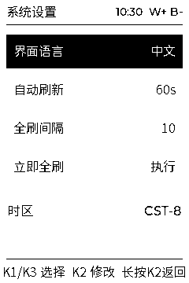 | 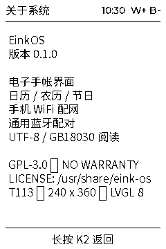 | 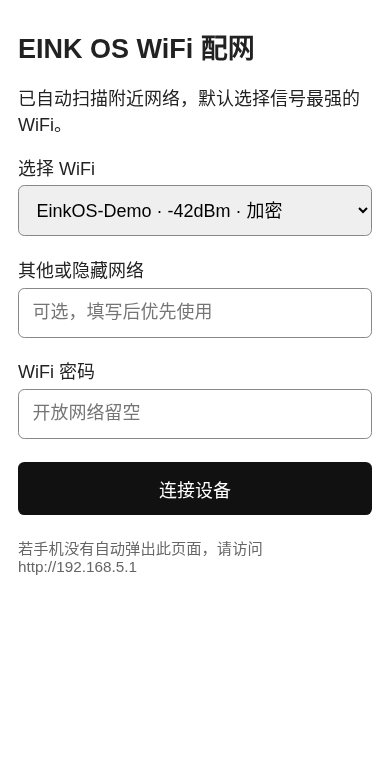 |

| 手机配网成功 | 手机配网失败 |  |
| --- | --- | --- |
| 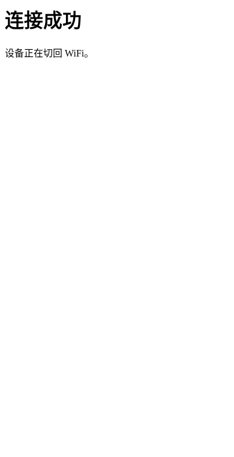 |  |  |

生成方法和来源哈希见 [截图说明](SCREENSHOTS.md)。新增页面必须同步扩充截图覆盖。
