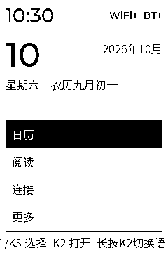

# 完成首次启动

本流程从已经烧录配套镜像、能够进入 Linux 的设备开始。尚未安装时先完成[系统烧录](INSTALL.md)。

## 1. 检查桌面与版本

在目标板串口终端执行：

```sh
eink-dashboard --version
ls -l /dev/epd_100ask
```

屏幕应显示日历、阅读、连接、更多四个入口。若设备节点不存在或桌面持续重启，先按[故障排查](TROUBLESHOOTING.md)处理。



## 2. 检查按键

| 操作 | 预期变化 |
| --- | --- |
| 短按 K1 或 K3 | 选中项向上或向下移动 |
| 短按 K2 | 打开当前选中应用 |
| 在应用内长按 K2 | 逐级返回；阅读正文先回书库 |
| 在主页长按 K2 | 切换主页中英文 |

长按判定阈值约 1.2 秒，确认键动作在松开后判定。页面切换全刷可能出现明显黑白变化，不应据此判断故障。

## 3. 连接 Wi-Fi 并校准时间

1. 打开“连接 → WiFi / 手机配网”，开始手机配网。
2. 在手机 Wi-Fi 设置中连接屏幕显示的 `EINKOS-` 热点，输入屏幕上的随机密码。
3. 自动配网页未出现时，在手机浏览器访问 `http://192.168.5.1`。
4. 选择目标网络或填写隐藏 SSID，输入密码并提交。
5. 连接成功后热点关闭，设备恢复 STA。确认桌面显示目标网络和 IP 地址，再检查日期与时间。

配网期间原 Wi-Fi 会断开。手机网页会上传手机当前时间，设备还会尝试 NTP 校时；不要仅凭“网络已连接”判断时间一定准确。

## 4. 导入并打开一本书

把 UTF-8 或 GB18030 编码的 `.txt` 文件复制到目标板 `/mnt/UDISK/books` 或 SD 卡的 `books` 目录。文件传输方法取决于当前镜像提供的接口，不默认承诺 SSH、ADB 或 USB 大容量模式已经启用。

进入“阅读”，确认书名出现在书库中，短按 K2 打开，使用 K1/K3 翻页。短按 K2 打开阅读菜单，可设置书签或返回书库。

检查续读时先正常退出桌面或重启服务，再打开同一文件；不要通过直接断电替代所有存储可靠性测试。

## 5. 检查蓝牙和诊断

需要蓝牙时进入“连接 → 蓝牙配对”，打开适配器并扫描。按屏幕提示确认或输入 PIN/passkey；具体操作见[用户指南](USER_GUIDE.md)。

显示“不可用”时先核对 `/dev/ttyS1`、厂商库和镜像配置。蓝牙不可用不应阻止日历、阅读器和桌面使用。

打开“更多 → 设备诊断”查看刷新统计和错误状态。记录应用版本、镜像版本以及异常日志，便于后续定位。
